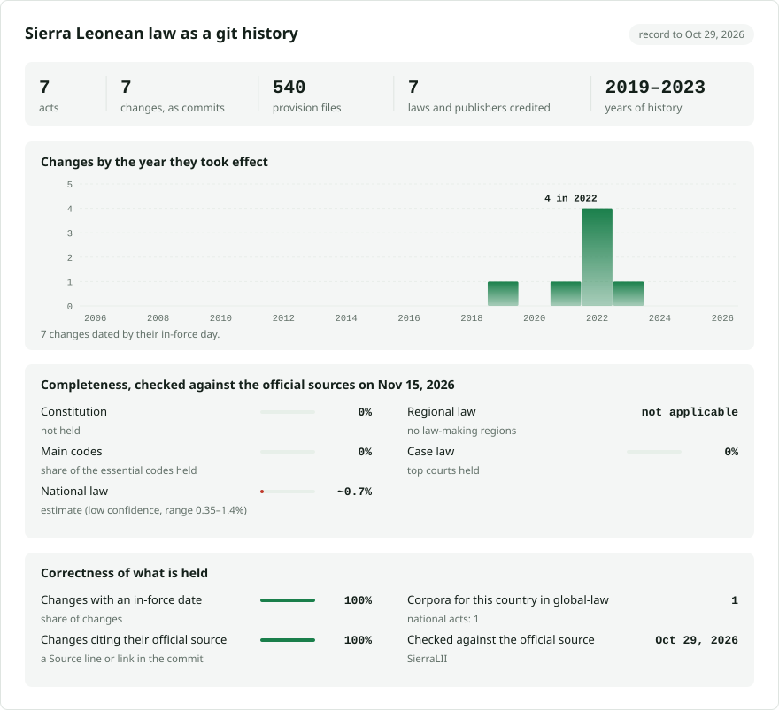

# Sierra Leone: law history in git

<picture>
<source media="(prefers-color-scheme: dark)" srcset="data/effort-dark.svg">

</picture>

The law of Sierra Leone as a git history: one file per section (or schedule), one commit per version on the day it took effect, and the law that made each change as the commit's author. `git blame` names the law behind every paragraph; `git log` lists every change to a section; picking a date gives the text in force that day.

Part of [lexifina/global-law](https://github.com/lexifina/global-law), one git history for every country's law: this is Sierra Leone's national law, which global-law reads at `sierra-leone/national/acts/`.

**What is in it now:** 7 acts, each with one version, the Act as enacted, from 2019 to 2023: the Employment Act, 2023 from SierraLII, and six Acts as printed by the Government Printing Department: the Banking Act, 2019, the Cyber Security and Crime Act, 2021, and the National Investment Board, Anti-Human Trafficking and Migrant Smuggling, Customary Land Rights and National Land Commission Acts, 2022. [`REPRODUCE.md`](REPRODUCE.md) lists every act with its source; [`data/laws.csv`](data/laws.csv) gives each one's enacted, published and in-force days.

Each act is a folder, one file per provision, plus a `README.md` listing its provisions (`employment/sec-071.md` is section 71 of the Employment Act, 2023, Act 15 of 2023: annual leave).

The text is in English, the language Sierra Leone's laws are published in, as SierraLII and the Government Printing Department print it.

## Questions as git commands

| Question | Command |
| --- | --- |
| Every change to section 71 of the Employment Act | `git log -p --word-diff -- employment/sec-071.md` |
| Which law wrote each line of section 71? | `git blame employment/sec-071.md` |
| Every version of the Employment Act, with the day each took effect | `git log --format="%h %(trailers:key=In-force,valueonly,separator=) %an" -- employment ':!*/README.md'` |
| Section 71 as in force on 1 January 2024 | `python tools/on.py 2024-01-01 employment sec-071` |

**Outside git**, we also host this record publicly, for free:

- **[Ask Claude about Sierra Leonean law](https://global-law.lexifina.com/v1/try_claude?country=sierra-leone)**: opens Claude with a first question ready.
- **[Ask ChatGPT](https://global-law.lexifina.com/v1/try_chatgpt?country=sierra-leone)**: the same question in ChatGPT.
- **[Search Sierra Leonean law on our site](https://lexifina.com/law?country=sierra-leone&q=annual+leave)**: a search for "annual leave", with each provision's text and its versions, no account needed.
- **[Developer REST API](https://global-law.lexifina.com/v1/search_law?query=annual+leave&jurisdiction=sierra-leone)**: the same search as JSON, with no key. See the [documentation here](https://lexifina.com/api/global-law).

Both assistants read the record through the free Global law connector (MCP, `https://global-law.lexifina.com/mcp`); the first time, the chat gives you the link that adds it. Ask in English.

**Host it yourself easily.** All it takes is git and Python, and the tools run on your machine:

```sh
git clone --depth 1 https://github.com/lexifina/global-law && cd global-law
python3 tools/countries.py add sierra-leone/national/acts
python3 tools/law.py show 2026-01-01 sierra-leone/national/acts/employment/sec-071.md
```

Opened in Claude Code, Cursor, VS Code or Codex, the clone also starts a local MCP server with the same tools ([MCP.md](https://github.com/lexifina/global-law/blob/main/MCP.md)).

## Dates

Each commit is dated at noon, Africa/Freetown, on the day the version took effect, and carries it in its `In-force:` trailer:

- an Act comes into operation on its publication in the Gazette, or on the date it prescribes (Constitution of Sierra Leone, 1991, s. 106(3));
- the six printed Acts leave their date of commencement blank, so each is dated by its Gazette (the Banking Act, 2019: Gazette No. 51 of 27 June 2019);
- the Employment Act, 2023 is dated by SierraLII's own date for it, its publication on 11 May 2023.

Each act is credited to itself as enacted (`Act No. 6 of 2019 <act-2019-6@sierralii.invalid>`; the Cyber Security and Crime Act, 2021 by its title), with an e-mail address that cannot exist, so `git blame` and `git log --author` name laws. The committer is always Lexifina.

## How it is checked

- `tools/check_repo.py` reads every version back from git on the day it took effect and on the day before, and compares it with the corpus: 7 versions of 7 acts, 0 mismatches, and no commit whose trailers git cannot parse (see [`REPRODUCE.md`](REPRODUCE.md)).
- Every printed word of the six Acts, from the enacting formula to "Passed in Parliament", is in a provision file, a Part heading or the printer's colophon, and none is added; the Employment Act's text, except headings and editorial notes, is checked to be in a provision file.
- A second build from the same corpus gave the same hashes for all 7 history commits and 14 tags.
- History is append-only: no merge commits, no commit dates that go backwards, and none after the build.
- [vulnerabilities/](vulnerabilities/): possible drafting mistakes in this law, found by global-law's detectors and checked by hand. Not run yet.

## What it does not show

- **Most Sierra Leonean law.** Only these 7 acts are here (SierraLII alone publishes about 80); there is no subordinate legislation, case law or bill.
- **Amendments.** Each act is held as enacted. No amending Act to the six printed Acts appears in Parliament's lists of Acts and Bills, but the annual Finance Acts were not read word for word; SierraLII holds no later version of the Employment Act.
- **The Constitution.** Its history from 1991 to 2016 (5 versions) is on the `preview` branch only: two Constitution (Amendment) Acts of 2022 have no usable text (a scan with an unusable OCR layer, an undated print), so its last version is not today's text.
- **Headings.** Part, Chapter and Division headings and SierraLII's editorial notes are left out; misspellings in the prints are kept as printed.

## Sources

| Source | Kind | Past versions | Notes |
| --- | --- | --- | --- |
| [Parliament of Sierra Leone](https://www.parliament.gov.sl) | Acts as passed and signed, printed by the Government Printing Department | no, the Act as enacted | Six Acts, read from the PDFs' text layer (no OCR), each from an Internet Archive copy |
| [SierraLII](https://sierralii.gov.sl) (Sierra Leone Legal Information Institute, on Laws.Africa's Peachjam) | Acts as published | no, one expression per act | The Employment Act, 2023, read from an archived copy pinned in `tools/sources.json` |

## Licence

See [`LICENSE`](LICENSE). SierraLII licenses its content under CC BY-NC 4.0, crediting SierraLII as the source (its terms of use, section 9), so its texts may be used only for non-commercial purposes; parliament.gov.sl states no licence for the Acts it publishes. Lexifina's own contributions (the arrangement of the history, the commit messages, the tables and the tools) are CC0 1.0.

No AI model wrote, translated or corrected legal text, and none runs when the history is built; the scripts were written by an AI model (see [`REPRODUCE.md`](REPRODUCE.md)).

## Visualisations

- [visualisations/](visualisations/): charts drawn from this repository. Not drawn yet.

## More

From [lexifina/global-law](https://github.com/lexifina/global-law):

- [FEATURES.md](https://github.com/lexifina/global-law/blob/main/FEATURES.md): every feature, and what every corpus must support (`git blame`, `law.py`, the MCP tools)
- [FAQ.md](https://github.com/lexifina/global-law/blob/main/FAQ.md): questions and answers · [CONTRIBUTING.md](https://github.com/lexifina/global-law/blob/main/CONTRIBUTING.md): proposing changes · [MCP.md](https://github.com/lexifina/global-law/blob/main/MCP.md): the MCP server · [REPRODUCE.md](https://github.com/lexifina/global-law/blob/main/REPRODUCE.md): how it was built · [CHANGELOG.md](https://github.com/lexifina/global-law/blob/main/CHANGELOG.md)
- [FRESHNESS.md](https://github.com/lexifina/global-law/blob/main/FRESHNESS.md): how current each corpus is · [Monitoring](https://github.com/lexifina/global-law/tree/main/monitoring): whether updates are running · [WATCHING.md](https://github.com/lexifina/global-law/blob/main/WATCHING.md): how each official source is watched for changes
- [performance/](https://github.com/lexifina/global-law/tree/main/performance): how fast the tools are, measured
- [visualisations/](https://github.com/lexifina/global-law/tree/main/visualisations): charts and bridges across the world's law
- [Vulnerabilities](https://github.com/lexifina/global-law/tree/main/vulnerabilities): mistakes in legislation as published
